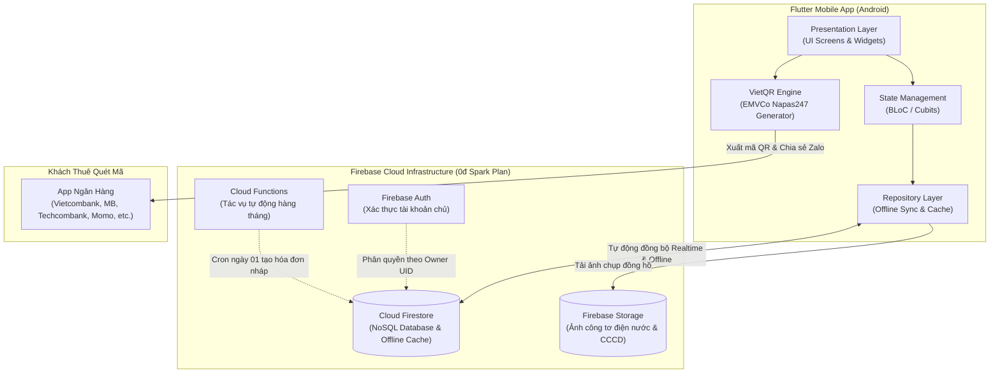

# Kiến Trúc Hệ Thống (System Architecture)

Hệ thống quản lý phòng trọ và ki-ốt cá nhân được thiết kế theo mô hình **Client-First & BaaS (Backend-as-a-Service)** với khả năng hoạt động ngoại tuyến (Offline-First) và thanh toán bán tự động qua mã VietQR chuẩn Napas 247.

---

## Các luồng nghiệp vụ cốt lõi

### 1. Luồng hoạt động ngoại tuyến (Offline-First Flow)
1. Chủ trọ cầm điện thoại xuống tầng hầm/góc khuất mất sóng 4G/WiFi.
2. Mở màn hình **Ghi điện nước** -> Nhập số điện/nước mới, chụp ảnh đồng hồ.
3. SDK `cloud_firestore` lập tức ghi dữ liệu vào bộ nhớ đệm cục bộ (Local Cache) của điện thoại và hiển thị trạng thái thành công ngay lập tức.
4. Khi chủ trọ quay lại khu vực có sóng WiFi/4G, SDK Firebase tự động đẩy các thay đổi lên máy chủ Cloud Firestore mà không yêu cầu bất kỳ thao tác thủ công nào.

### 2. Luồng thanh toán VietQR bán tự động (Semi-Automated Payment)
1. Sau khi chốt số điện nước, hệ thống tự động tính thành tiền hóa đơn.
2. Chủ trọ bấm nút **Mã QR** trên hóa đơn:
   - Module `VietQRHelper` tự động biên dịch thông tin số tài khoản, số tiền và cú pháp (`PHONG [TenPhong] THANG [Thang]`) thành chuỗi chuẩn EMVCo Napas.
   - Ứng dụng render mã QR ngay trên màn hình mà không cần gọi API ngân hàng ngoài.
3. Chủ trọ bấm **Gửi qua Zalo**: Tin nhắn văn bản chi tiết tiền phòng + mã QR được chia sẻ trực tiếp tới khách thuê.
4. Khi nhận được tiền báo về SMS/App ngân hàng, chủ trọ chỉ cần bấm nút **Xác nhận đã nhận đủ tiền** trên ứng dụng để hóa đơn chuyển sang trạng thái `Đã thanh toán`.
